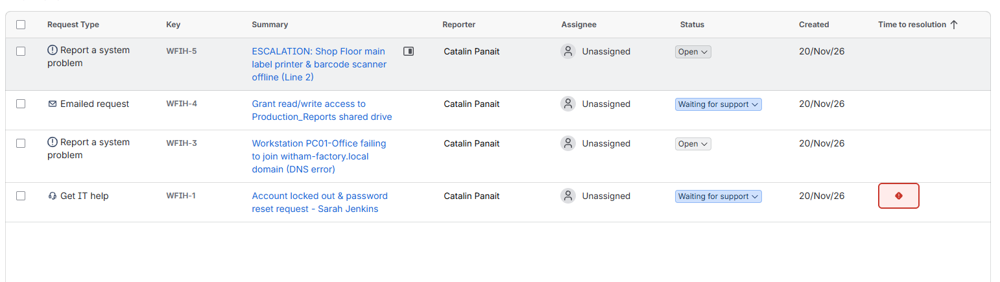
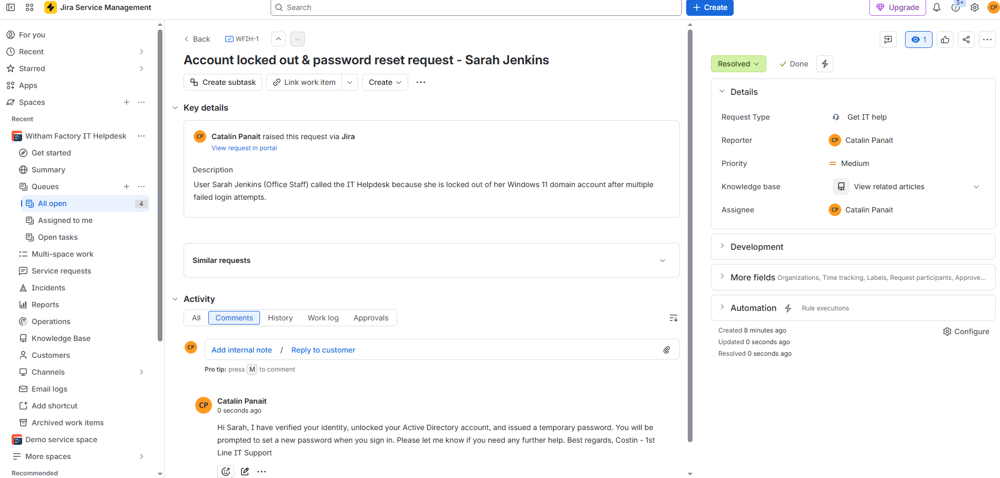
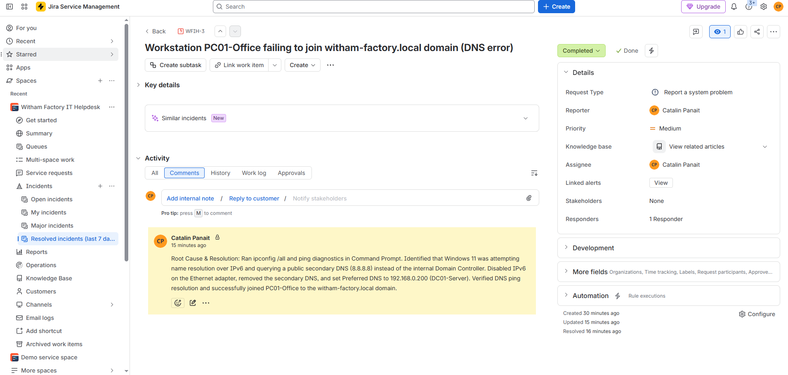
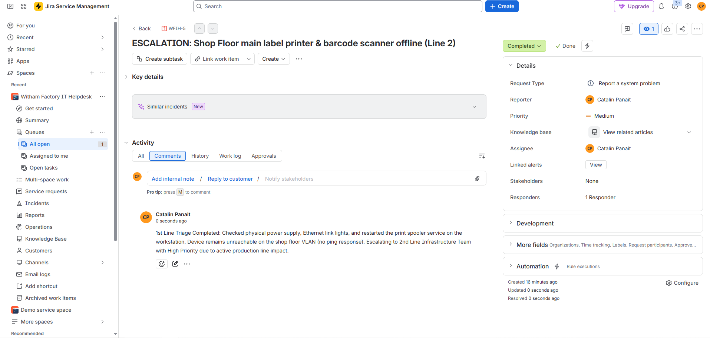
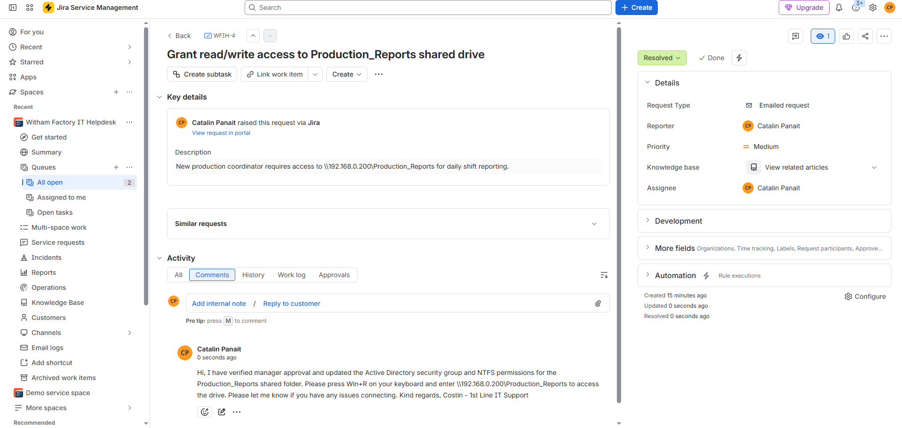

# IT Helpdesk Ticketing, Incident Management & Customer Service Lab

## Project Overview
This project simulates a real-world **1st Line IT Service Desk** workflow for a hybrid corporate and manufacturing environment (`Witham Factory IT Helpdesk`) using **Jira Service Management**. It demonstrates structured ticket triage, ITIL categorization (Incidents vs. Service Requests), SLA awareness, clear end-user communication, technical troubleshooting, and proper 2nd Line escalation.

## Key Skills Demonstrated
* **ITSM & Ticketing Tools:** Jira Service Management (Queues, Priorities, SLAs, Resolutions)
* **ITIL Service Operations:** Differentiating between *Service Requests* and *Incidents*
* **Customer Service & Communication:** Empathetic, jargon-free written responses to end users
* **Technical Troubleshooting & Escalation:** Root cause documentation (`ipconfig`, `ping`, DNS/IPv6) and structured escalation to 2nd Line Infrastructure teams

---

## Ticket Lifecycle & Evidence

### 1. Service Desk Queue & Ticket Triage Overview
Managed incoming user requests and technical incidents in a centralized queue, assigning ownership, setting priorities, and tracking resolution statuses.

### 2. Service Request & Customer Service Communication (`WFIH-1`)
Handled an account lockout and password reset request for an office employee (`Sarah Jenkins`). Verified identity, unlocked the Active Directory account, and provided a polite, clear update to the user.

### 3. Technical Incident Troubleshooting & Root Cause Documentation (`WFIH-3`)
Investigated a Windows 11 workstation (`PC01-Office`) failing to join the `witham-factory.local` domain. Documented command-line diagnostics (`ipconfig /all`, `ping`), disabled IPv6 interference, pointed Preferred DNS to `192.168.0.200`, and verified domain join success.

### 4. High-Priority Incident Triage & 2nd Line Escalation (`WFIH-5`)
Performed 1st Line physical and network checks (power, Ethernet link, print spooler service, VLAN ping test) on an offline shop-floor label printer impacting dispatch operations, then escalated with full diagnostic notes to the 2nd Line Infrastructure Team.

### 5. Access Management & Shared Drive Provisioning (`WFIH-4`)
Verified manager approval for access to the `Production_Reports` network share, updated Active Directory / NTFS permissions, and guided the end user with simple connection instructions.

